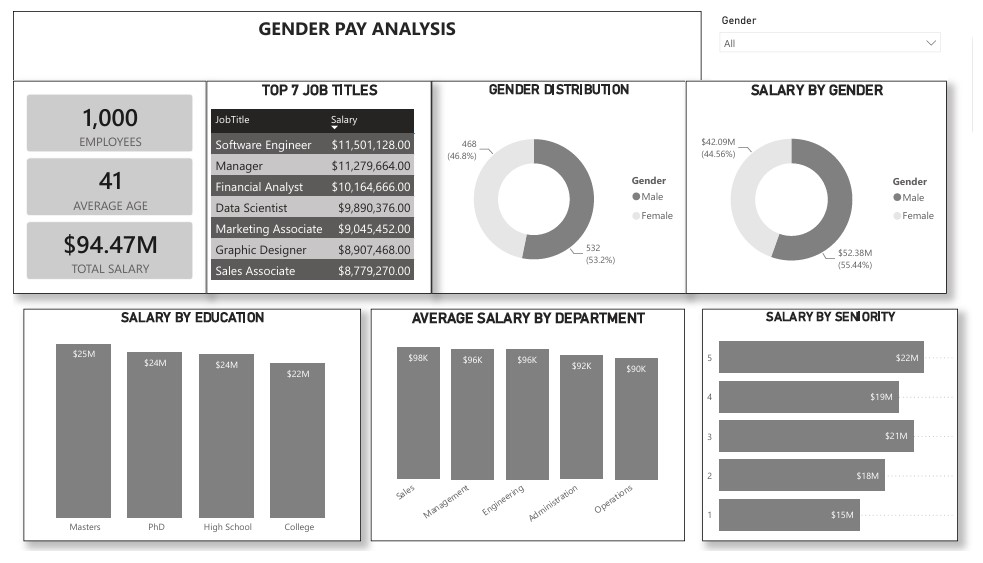

# Compensation & Pay Equity Diagnostic Analysis

## Executive Summary

This project evaluates compensation patterns across a 1,000-employee organization to determine whether observed gender pay differences can be explained by legitimate workforce characteristics such as department, seniority, education, job role, and performance.

The analysis identified an organization-wide **9.5% unadjusted gender pay gap**, with average base pay of approximately **$98,458 for men versus $89,943 for women**.

Rather than treating the headline gap as conclusive, the analysis progressively segmented compensation across organizational dimensions to test whether the difference disappeared within more comparable employee groups.

It did not.

Women earned less on average across all five departments, while some of the largest disparities occurred at early-career seniority levels. Performance ratings showed almost no relationship with compensation, weakening performance as a plausible explanation for the observed difference.

The findings indicate a material compensation-equity risk requiring deeper statistical validation and targeted review of early-career and starting-pay practices.

---

## Business Context

Leadership required an evidence-based view of whether compensation outcomes were broadly consistent across the workforce.

The organization had employee-level information covering:

- Gender
- Department
- Job title
- Seniority
- Education
- Performance evaluation
- Base pay
- Bonus

However, the data had not been consolidated into a decision-support framework capable of answering a more important question:

> Are observed compensation differences consistent with legitimate workforce characteristics, or do unexplained disparities remain after employees are compared across relevant organizational dimensions?

This analysis was designed as an initial diagnostic rather than a legal or causal determination of pay discrimination.

---

## Analytical Objectives

The analysis focused on five questions:

1. **Magnitude**  
   Is there a measurable organization-wide gender pay gap?

2. **Consistency**  
   Does the gap persist within individual departments?

3. **Seniority Effect**  
   Does career level explain the observed difference, or does a gap remain within seniority bands?

4. **Performance Effect**  
   Can differences in employee performance plausibly explain compensation variation?

5. **Structural Drivers**  
   To what extent do education and job role account for compensation differences?

The purpose was to move from a simple descriptive comparison toward a structured compensation diagnostic.

---

## Tools & Analytical Methods

### Technology

- Power BI
- Power Query
- DAX
- Microsoft Excel

### Analytical Techniques

- Compensation benchmarking
- Gender pay-gap analysis
- Multi-dimensional segmentation
- Department-level variance analysis
- Seniority-band analysis
- Education-based compensation analysis
- Job-role comparison
- Performance/pay correlation analysis
- KPI development
- Executive dashboard design

---

## Data Scope

The analysis covered **1,000 employee records** across five organizational functions:

- Sales
- Engineering
- Management
- Administration
- Operations

Key variables included employee ID, job title, gender, age, department, education, seniority level, performance evaluation, base pay, and bonus.

---

## Analytical Framework

A headline gender pay gap can be misleading if men and women are distributed differently across departments, roles, or seniority levels.

The analysis therefore used a layered approach:

**Organization → Department → Seniority → Education → Role → Performance**

The purpose was to determine whether the headline disparity weakened or disappeared as increasingly relevant workforce characteristics were considered.

This approach does not replace multivariate regression, but it provides a stronger diagnostic foundation than an organization-level comparison alone.

---

## Dashboard Preview

---

# Compensation Diagnostic

## 1. A Material Organization-Wide Pay Gap Exists

Average base salary was approximately:

- **Men: $98,458**
- **Women: $89,943**

This represents an unadjusted difference of approximately **$8,500 per employee**, or **9.5%**.

The gap also remained when bonus compensation was included.

### Business Interpretation

The headline difference is large enough to warrant investigation, but an aggregate gap alone cannot establish its cause.

Differences in occupational mix, seniority, experience, education, location, or other legitimate factors may contribute to the result.

The more important analytical question is therefore whether the gap disappears when employees are segmented into increasingly comparable groups.

---

## 2. Department Mix Does Not Fully Explain the Gap

Female employees earned less on average than male employees in **all five departments**.

Department-level gaps ranged from approximately:

- **6.9% in Management**
- to **10.2% in Sales**

### Business Interpretation

This materially weakens the hypothesis that the company-wide difference exists only because men and women work in different departments.

The persistence of the gap inside each department shifts the investigation toward factors such as:

- job-level distribution
- starting compensation
- promotion history
- tenure
- individual role
- negotiation practices
- compensation adjustments over time

---

## 3. Early-Career Compensation Represents the Highest-Risk Area

The largest disparities appeared primarily at **Seniority Levels 1 and 2**.

The most pronounced observed gap reached approximately **26.9% in Sales at Seniority Level 2**.

At the same time, overall compensation increased predictably with seniority:

- **Level 1: ~$76,840**
- **Level 5: ~$113,478**

### Business Interpretation

The organization's seniority framework itself appears directionally logical: higher levels receive higher average compensation.

The risk lies in differences **within the same career levels**.

The concentration of larger gaps at early-career levels raises a particularly important hypothesis:

> Differences may be entering the compensation system through starting salaries or early salary adjustments and subsequently compounding through employees' careers.

This should be formally tested rather than assumed.

---

## 4. Performance Does Not Explain Compensation Differences

The correlation between employee performance evaluation and base pay was approximately:

**r = -0.05**

This is effectively no linear relationship.

Average compensation was also relatively flat across performance-rating categories.

### Business Interpretation

Performance ratings provide little evidence that higher-paid employees are systematically receiving higher evaluation scores.

Consequently, performance should not be used on its own to justify observed compensation disparities.

This result also raises a broader compensation-management question:

If performance has almost no relationship with compensation, how effectively is performance being incorporated into reward decisions?

That question extends beyond pay equity into the organization's overall compensation philosophy.

---

## 5. Education Influences Pay, but Does Not Resolve the Equity Question

Average compensation increased with educational attainment.

For example:

- **High School: ~$88,732**
- **PhD: ~$99,881**

### Business Interpretation

Education behaves as expected and appears to be a legitimate contributor to compensation differences.

However, education alone does not explain why gender differences remain within other organizational segments.

This reinforces the need for multivariate analysis rather than relying on any single explanatory variable.

---

## 6. Job Role Is a Major Compensation Driver

Pay varied substantially by job title.

For example:

- Managers averaged approximately **$125,330**
- Marketing Associates averaged approximately **$76,656**

### Business Interpretation

Role is clearly one of the strongest legitimate determinants of compensation.

This means the organization-level 9.5% figure should **not** be interpreted as an adjusted pay-equity estimate.

A defensible equity assessment should compare employees while controlling for job role alongside other relevant factors.

---

# Risk Assessment

The analysis identifies four areas requiring management attention.

### Compensation Risk

Persistent gender differences remain visible across departments and career levels.

### Talent Risk

If early-career employees enter on unequal salary trajectories, disparities may compound over time and contribute to retention problems.

### Governance Risk

Without structured compensation monitoring, inconsistencies may persist until an annual compensation review or external audit identifies them.

### Decision-Making Risk

Using performance scores as a primary explanation for compensation differences would be unsupported by the current data.

---

# Recommended Management Actions

## 1. Conduct a Formal Adjusted Pay-Equity Audit

Move from descriptive segmentation to multivariate statistical modelling.

A regression model should control for variables such as:

- job role
- seniority
- tenure
- education
- location
- relevant experience

Gender should then be evaluated after these factors have been accounted for.

This would distinguish the **unadjusted 9.5% gap** from any remaining adjusted difference.

---

## 2. Prioritize Early-Career Compensation

Review Seniority Levels 1–2 first because the largest observed differences are concentrated there.

Analysis should include:

- starting salary
- offer negotiation
- hiring salary bands
- promotion increases
- annual adjustment history

The objective should be to determine whether disparities enter the system at hiring or emerge later.

---

## 3. Perform a Dedicated Sales Compensation Review

Sales recorded the widest department-level gender gap and the most pronounced seniority-specific disparity.

Review:

- starting offers
- compensation bands
- variable compensation structures
- promotion history
- negotiation outcomes

This should be treated as a priority diagnostic area rather than assuming the organization-wide policy operates consistently across all functions.

---

## 4. Establish Compensation Guardrails

Introduce formal controls around:

- salary bands
- starting-offer ranges
- promotion increases
- exception approvals
- out-of-band compensation

Any significant deviation from established ranges should require documented justification.

---

## 5. Separate Performance Management from Pay-Equity Validation

Performance should remain part of compensation decision-making where appropriate, but the current data does not support using employee ratings as an explanation for the observed gender gap.

Compensation decisions should therefore be evaluated independently for equity before performance is used as justification.

---

## 6. Build Continuous Pay-Equity Monitoring

Move from annual retrospective analysis toward recurring compensation monitoring.

The Power BI dashboard could be extended to monitor:

- gender pay gap
- adjusted pay gap
- salary-band penetration
- starting salary by demographic group
- promotion increase percentages
- bonus allocation
- seniority-level disparities
- department-level exceptions

This would turn pay equity from a one-off audit into a governance process.

---

# Further Analysis

The current project provides a strong descriptive and diagnostic foundation, but several additional variables would strengthen a formal pay-equity assessment.

Future analysis should incorporate:

- employee tenure
- prior experience
- geographic location
- employment type
- promotion history
- starting salary
- salary adjustment history
- working hours/FTE status
- variable compensation structure

A multivariate regression or matched-employee analysis could then estimate whether a statistically significant gender coefficient remains after legitimate compensation drivers are controlled.

---

# Business Impact

The project transforms a static HR compensation dataset into a management-level diagnostic framework.

Rather than reporting only a headline gender difference, the analysis identifies:

- where compensation disparities are concentrated
- which explanations are supported by the data
- which explanations are weakened by the evidence
- where management should investigate first
- what additional data is required for a defensible adjusted analysis
- how Power BI can support continuous compensation governance

This allows HR and leadership to move from reactive compensation review toward structured, evidence-based pay-equity management.

---

## Skills Demonstrated

- Compensation Analytics
- HR Analytics
- Power BI
- Power Query
- DAX
- Multi-dimensional Segmentation
- Pay-Gap Analysis
- Correlation Analysis
- Compensation Benchmarking
- KPI Development
- Analytical Hypothesis Testing
- Risk Identification
- Executive Reporting
- Data Storytelling
- Strategic Recommendation Development
- Governance-focused Analytics

---

## Project Files

- [Power BI Dashboard](Compensation_Pay_Equity_Power_BI.pbix)
- [Pay Equity Case Study](pay_equity_case_study.pdf)
